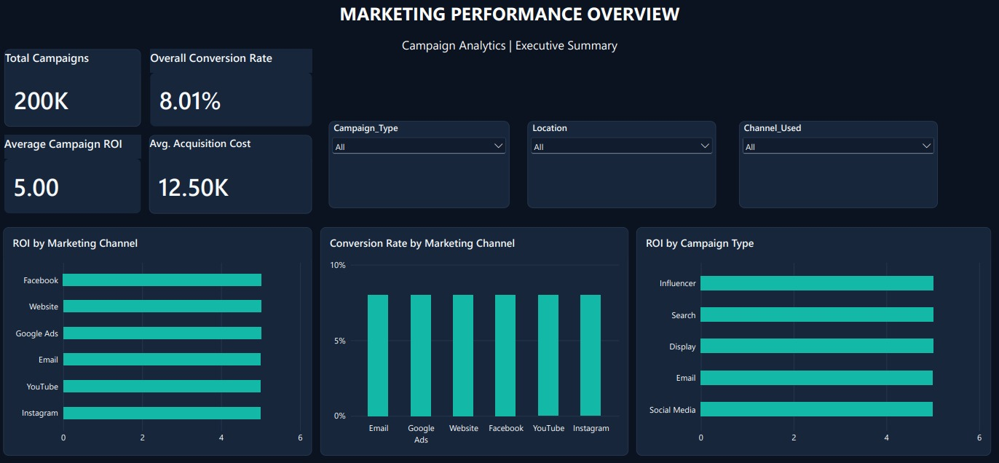
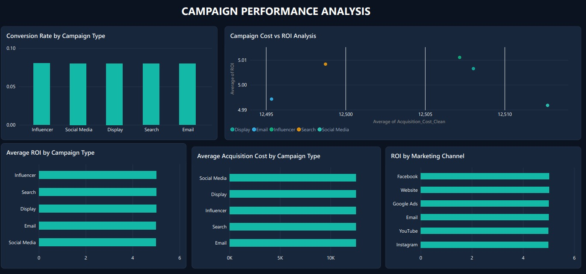
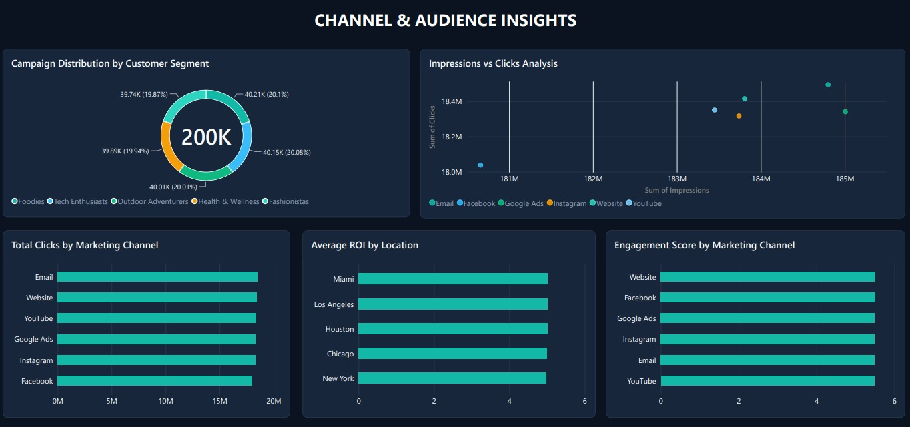
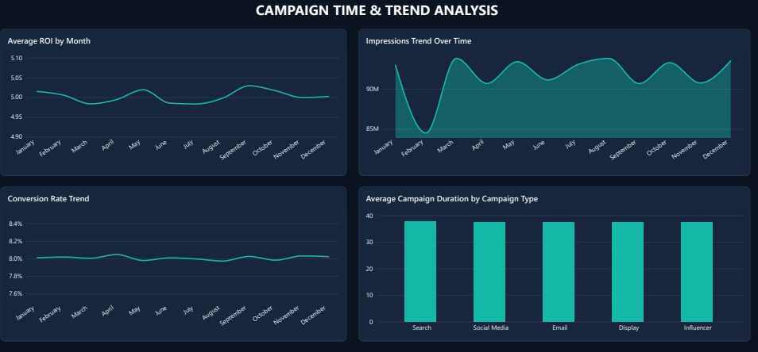

# Marketing Campaign Performance Analysis

An end-to-end analytics project: raw campaign data → **SQL Server** profiling and cleaning → a 4-page, custom-themed **Power BI** dashboard.



## Project Overview

The goal was to build a clean, reproducible pipeline and an executive-style dashboard that answers common marketing questions:

- How do campaigns perform in terms of **ROI, conversion rate and acquisition cost**?
- Do results differ by **channel, campaign type, customer segment, audience or location**?
- How do impressions, conversion and ROI **change over time**?

## Dataset

| | |
|---|---|
| Rows | 200,000 campaigns |
| Columns | 16 (campaign, company, type, audience, channel, location, language, cost, ROI, conversion rate, clicks, impressions, engagement score, customer segment, date, duration) |
| Period | 2021-01-01 to 2021-12-31 |
| Source | [Marketing Campaign Performance Dataset on Kaggle](https://www.kaggle.com/datasets/manishabhatt22/marketing-campaign-performance-dataset) (the CSV is not included in this repo because of its size) |

> **Note:** the dataset appears to be **synthetic** (values are evenly distributed and uncorrelated). It is used here to demonstrate the technical workflow, not to draw real business conclusions.

## Tools

- **SQL Server (T-SQL):** data profiling, cleaning, view creation, analysis queries
- **Power BI Desktop:** data model, DAX measures, dashboard design
- **Custom Power BI theme:** dark navy + teal/emerald palette, Segoe UI

## Workflow

1. **Create database and import data** into `dbo.Marketing_Campaigns`.
2. **Profile data quality:** missing values, duplicate IDs, valid ranges.
3. **Clean:** `Acquisition_Cost` is stored as text (e.g. `$16,174.00`) and converted to `DECIMAL(18,2)` in the view `vw_Marketing_Campaigns_Clean`.
4. **Analyze** performance by channel, campaign type, segment, audience, location and month.
5. **Visualize** in Power BI (connected to the clean view). `Duration_Days` is derived in Power BI from the `Duration` text column (15 / 30 / 45 / 60 days).

### Data quality results

- 0 missing values, 0 duplicate campaign IDs
- All conversion rates (0.01–0.15), engagement scores (1–10), clicks and impressions are within valid ranges
- Every `Acquisition_Cost` value converted successfully

## Dashboard Pages

| Page | What it shows |
|---|---|
| **Marketing Performance Overview** | KPI cards (campaigns, ROI, conversion rate, acquisition cost), slicers, ROI and conversion by channel and campaign type |
| **Campaign Performance** | Conversion, ROI and cost by campaign type, cost vs ROI scatter |
| **Channel & Audience Insights** | Segment distribution, impressions vs clicks, clicks, engagement and ROI by channel and location |
| **Campaign Time & Trend Analysis** | Monthly ROI, conversion rate and impressions trends, average duration by campaign type |

### Screenshots







> The Power BI file (`.pbix`) is not included in this repository. The screenshots above show the final dashboard, and the SQL scripts reproduce the data preparation.

## Key Findings

| KPI | Value |
|---|---|
| Total campaigns | 200,000 |
| Average ROI | 5.00 |
| Average conversion rate | 8.01% |
| Average acquisition cost | $12,504 |
| Average engagement score | 5.50 |

- **Performance is uniform across every dimension.** Average ROI differs by less than 1% between channels (4.99–5.02), campaign types (4.99–5.01), segments and locations (4.98–5.01). Conversion rate is about 8% everywhere.
- **No meaningful relationships:** ROI, cost, clicks, impressions and engagement are essentially uncorrelated.
- **Monthly ROI stays between 4.98 and 5.03.** The February dip in total impressions reflects a 28-day month, not weaker performance.
- Bar charts start at zero. The trend and scatter charts use zoomed axes so small movements are visible, but the actual differences are under 1%, so they should not be read as meaningful.

**Takeaway:** in this dataset no channel or campaign type outperforms the others. With real campaign data, the same pipeline and dashboard would surface genuine differences.

## Repository Structure

```
├── README.md
├── Marketing_Analytics_Analysis.sql      (profiling, cleaning view, analysis queries)
├── 01_marketing_performance_overview.jpeg
├── 02_campaign_performance_analysis.jpeg
├── 03_channel_audience_insights.jpeg
└── 04_campaign_time_trend_analysis.jpeg
```

## How to Reproduce

1. Create the database `Marketing_Analytics` and import the dataset into SQL Server as `dbo.Marketing_Campaigns` (e.g. SSMS → *Tasks → Import Flat File*).
2. Run `Marketing_Analytics_Analysis.sql` from top to bottom: it profiles the data, creates the view `dbo.vw_Marketing_Campaigns_Clean`, and runs the analysis queries.
3. In Power BI Desktop, connect to your server and load the view, then build the visuals shown in the screenshots.

## Author

**Omar Saad** · Commerce student (Faculty of Commerce, Assiut University) learning data analytics
